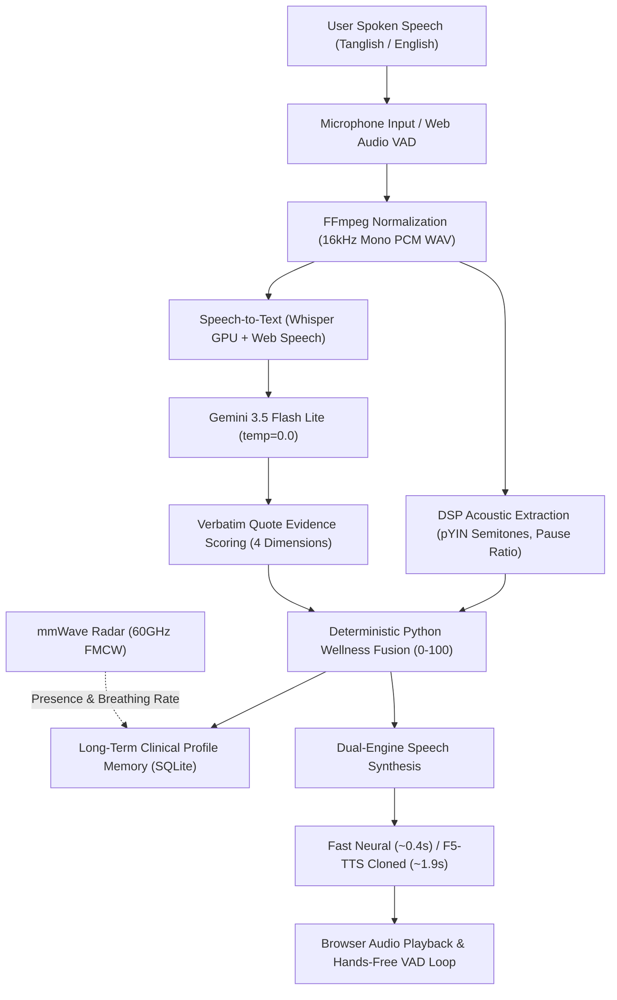

# 🌿 Arogya • Embodied Voice Companion & Acoustic Biomarker Mental Health AI

> **A real-time bilingual voice companion robot and longitudinal mental health intelligence platform featuring authentic Tanglish & English voice cloning, hands-free conversational VAD, non-contact mmWave vital radar sensing, and deterministic quote-grounded evidence scoring.**

---

## 🌟 Executive Overview

**Arogya** is designed to live in the user’s room as a physical, real-world presence that understands both emotional and physiological states — even before the user speaks. 

Existing solutions suffer from three fatal flaws:
1. **Linguistic Stigma:** Indian youth express their deepest emotions in colloquial vernaculars (**Tanglish** — Tamil naturally blended with English). Conventional chatbots reply in stiff, unnatural English.
2. **Neglect of Acoustic & Physical Biomarkers:** Depression, anxiety, and burnout manifest in pitch flattening ($f_0$ semitone variance), pause ratios, and rapid shallow breathing. Text chatbots cannot detect any of this.
3. **The "Silent Suffering" Barrier:** When individuals are severely overwhelmed, they lack the energy to type into a phone. Arogya's ambient companion robot senses presence and vital signs via **60GHz mmWave radar** and speaks with a human voice to de-escalate stress proactively.

---

## 🚀 Key Features

### 1. Dual-Engine Speech Synthesis (Authentic Tanglish & English)
- **Cloned Studio Mode (F5-TTS Flow-Matching):** GPU-accelerated zero-shot voice cloning (~1.9s on RTX 3050) generating natural, warm female cadence in fluent Tanglish and Indian English without robotic artifacts.
- **Fast Neural Mode (`en-IN-NeerjaNeural`):** Sub-second edge neural synthesis (~0.4s) for rapid, seamless conversational exchange.

### 2. Hands-Free Ambient Conversational Mode (Full-Duplex VAD)
- Operates naturally like a friend in the room.
- Web Audio API energy detection senses when the user speaks and automatically submits upon a **1.4-second natural pause**.
- Plays Arogya's response and automatically resumes listening without requiring manual clicks.

### 3. Interactive Guided Calming Breathing (High-End Concentric Animation)
- Real-time somatic grounding engine with smooth, cubic-bezier pulsating concentric rings and **432Hz harmonic acoustic chimes**.
- Supports **Box Breathing (4-4-4-4)** and **Calming Vagus Stimulation (4-7-8)** with live phase countdowns.
- **Automatic Tension Trigger:** Gentle invitation pill automatically appears whenever speech evaluation detects stress or anxiety $\ge 2/3$.

### 4. Zero-Hallucination Evidence Scoring
- Evaluates 4 core symptom dimensions: *Stress & Pressure*, *Worry & Apprehension*, *Fatigue & Low Energy*, and *Emotional Heaviness*.
- **Strict Empirical Criteria:** Requires verbatim transcript quotes for every awarded point. **"No quote = No points"**.
- Overall wellness score (0–100) and statistical confidence are deterministically calculated in Python code.

### 5. Scientific DSP Acoustic Biomarkers
- Probabilistic YIN (`librosa.pyin`) fundamental frequency ($f_0$) tracking.
- Speaker-normalized, pitch-invariant semitone deviation:
  $$\text{semitones} = 12 \cdot \log_2\left(\frac{f_0}{\text{median}(f_0)}\right)$$
- Extraction is decoupled from the LLM prompt to prevent subjective hallucination.

### 6. Dedicated Separate Analytics & Trajectory Portal (`/analytics`)
- Standalone analytics dashboard displaying multi-session longitudinal wellness curves, trajectory delta ($\Delta = \text{recent} - \text{baseline}$), symptom distributions, and voice biomarker history.
- One-click export of structured clinical reflection reports in Markdown format.

### 7. Long-Term Clinical Profile & Stressor Memory
- Persistent SQLite memory (`user_clinical_profile`) tracking key user context (academics, placement interviews, sleep habits), recurring stressor clusters, and proven coping mechanisms.
- Arogya naturally references previous discussions across different days.

### 8. Embodied Hardware & Non-Contact mmWave Sensing Architecture
- Connects with **60GHz FMCW mmWave radar** (e.g., HLK-LD2410 / Seeed Studio mmWave) over ESP32 UART.
- Measures presence, respiratory rate (breaths/min), and heart-rate variability non-invasively through chest-wall micromotions without intrusive cameras or wearables.

### 9. Immediate Crisis Safety Triage
- Independent safety filter detecting acute crisis or self-harm ideation without corrupting numerical scores.
- Immediate direct integration with **Tele-MANAS (14416)**, **KIRAN (1800-599-0019)**, and **Vandrevala Foundation**.

### 10. Google OAuth 2.0 Authentication & Multi-User Data Isolation
- **100% Free Google Sign-In:** Leverages Google Identity Services (GSI) web SDK with zero third-party subscription fees or quotas.
- **Strict User Privacy Isolation:** User reflections, voice prosody recordings, mental health records, and clinical memory profiles are keyed to each individual user ID.
- **Seamless Local Demo Mode:** Supports 1-click test profiles (`Logeshwaran` and `Dr. Sarah Chen`) for rapid local evaluation without requiring an immediate Google Cloud console configuration.

---

## 🛠️ System Architecture



---

## 📦 Tech Stack

- **Backend:** Python 3.10+, FastAPI, Uvicorn, SQLite3 (WAL mode)
- **AI Models:** F5-TTS (Flow-matching diffusion), Google Gemini API (`gemini-3.5-flash-lite`), Edge-TTS (`en-IN-NeerjaNeural`), OpenAI Whisper
- **Audio DSP:** Librosa, SoundFile, NumPy, FFmpeg
- **Frontend:** HTML5 Canvas, Vanilla CSS3 (Editorial Monochrome system), JavaScript (ES6+), Web Audio API
- **Hardware Interface:** ESP32-S3, UART/Serial protocol (`pyserial`), 60GHz FMCW mmWave radar

---

## ⚡ Quick Start Guide

### 1. Prerequisites
- Python 3.10 or 3.11
- NVIDIA GPU with CUDA 12.1+ (Recommended for F5-TTS; CPU works for Fast Neural mode)
- [FFmpeg](https://ffmpeg.org/download.html) installed and accessible in PATH or root directory

### 2. Clone and Setup
```bash
git clone https://github.com/logesh-profile/arogya.git
cd arogya

# Create and activate virtual environment
python -m venv venv
# Windows:
venv\Scripts\activate
# Linux/macOS:
source venv/bin/activate

# Install dependencies
pip install -r requirements.txt
```

### 3. Environment Variables
Create a `.env` file inside `mental_health_voice_ai/`:
```bash
GEMINI_API_KEY=your_gemini_api_key_here
GOOGLE_CLIENT_ID=your_google_oauth_client_id_here.apps.googleusercontent.com  # Optional for production Google Sign-In
```

### 4. Launch Arogya
```bash
python mental_health_voice_ai/run_arogya.py
```
Open **`http://localhost:8000`** in Chrome or Edge.

---

## 📊 Key API Endpoints

| Endpoint | Method | Description |
| :--- | :--- | :--- |
| `/` | `GET` | Main companion conversational interface |
| `/analytics` | `GET` | Dedicated separate longitudinal analytics portal |
| `/api/auth/me` | `GET` | Active authenticated user profile and session state |
| `/api/auth/google` | `POST` | Authenticate via Google OAuth 2.0 credential token |
| `/api/auth/demo` | `POST` | Switch between local demo profiles (Logeshwaran / Dr. Sarah Chen) |
| `/api/auth/logout` | `POST` | Terminate session and clear authentication cookie |
| `/api/chat/voice` | `POST` | Core speech-to-speech loop with evidence scoring & prosody |
| `/api/chat/text` | `POST` | Rapid text chat with grounded evidence & titling |
| `/api/analytics/summary` | `GET` | Longitudinal multi-session metrics, trend points & profile |
| `/api/analytics/export/download` | `GET` | Download full clinical reflection report (Markdown) |
| `/api/greeting` | `GET` | Instant studio greeting personalized by memory |

---

## 🔒 Ethical AI & Clinical Scope Disclaimer
*Arogya is designed as an everyday emotional decompression companion, somatic grounding guide, and early-warning wellness triage aid. It is not a licensed medical device and does not diagnose psychiatric conditions or replace a human clinical psychologist. In cases of acute crisis, immediate referral to national toll-free helplines (Tele-MANAS: 14416) is automatically presented.*

---

## 📄 License
MIT License. Developed for mental health accessibility and voice-first companion robotics.
